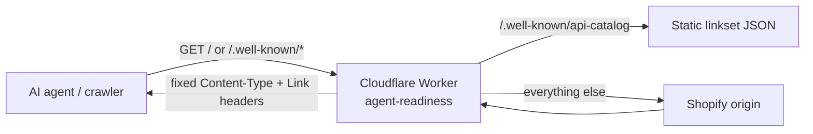

# kissmyskills-agent-readiness

**A 100-line Cloudflare Worker that makes a Shopify storefront readable for AI agents - without touching the store itself.**

## The problem

AI agents (ChatGPT, Claude, Perplexity, shopping agents) increasingly fetch a store's homepage and ask for machine-readable formats. On [kissmyskills.com](https://kissmyskills.com), a Shopify store, two things broke them:

1. The origin echoed the request's `Accept` header back as `Content-Type`. An agent asking for `text/markdown` received an HTML body labelled as markdown, and its parser failed.
2. There was no standard way for an agent to discover the store's machine-readable files (`llms.txt`, `agents.md`, sitemap, Shopify's own `/.well-known/ucp`).

Shopify does not let you change either of these from the theme.

## What it does

| # | Fix | Standard |
|---|---|---|
| 1 | Rewrites a mislabelled `Content-Type` back to `text/html` when the body is actually HTML | - |
| 2 | Adds `Link` headers on the homepage pointing to the agent-readable files | RFC 8288, RFC 9727 §3 |
| 3 | Serves `/.well-known/api-catalog` as a linkset | RFC 9727 |

Equally important is what it deliberately does **not** do: no A2A agent card, MCP server card, x402 or similar. Each of those would advertise an interface the site does not have, and an agent that trusted it would land on a 404.

## Architecture

The Worker is attached to only two routes: the homepage and `/.well-known/*`. It is intentionally not on `/*`, so a bad deploy can never take the shop down. Rollback is one command (`wrangler rollback`), and full removal returns the site to serving straight from Shopify.

## Stack

Cloudflare Workers (plain JavaScript, no dependencies), Wrangler.

## My role

I am a Senior Product Manager. I spotted the problem while working on AI-search visibility (AEO) for my own store, scoped the fix down to the smallest change that solved it, wrote the spec, and built and shipped it with Claude Code. The scoping decisions (two routes only, no speculative agent cards) are the product work here.
